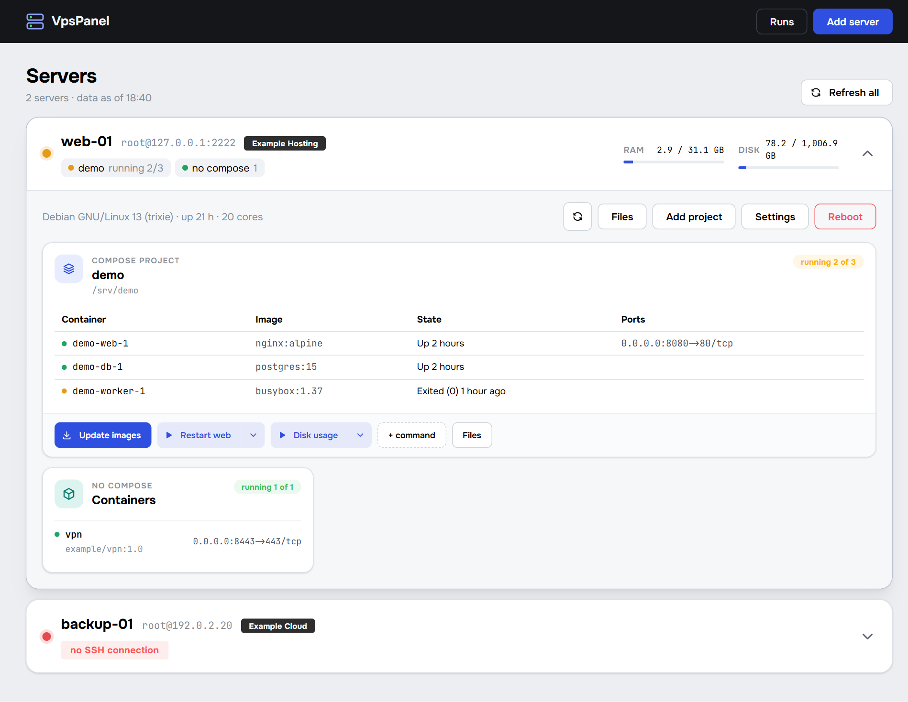
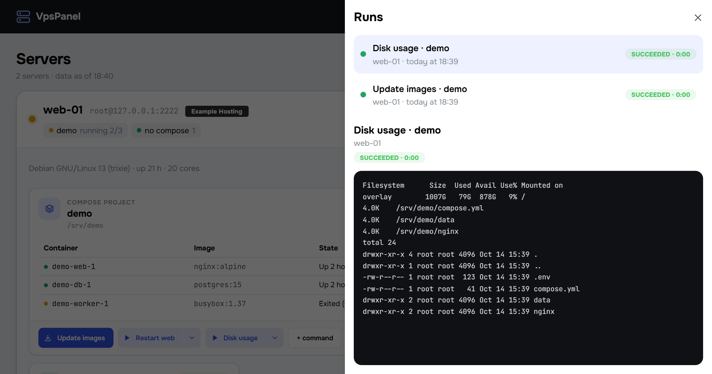
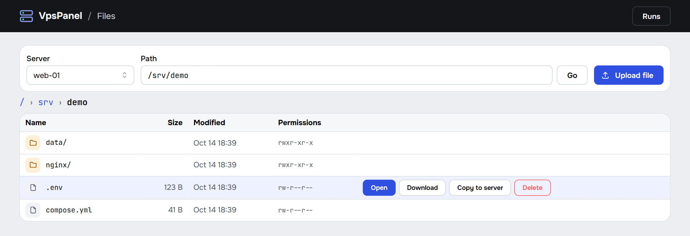
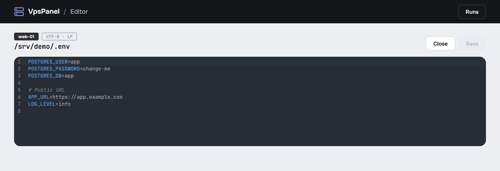

# VpsPanel

A small panel for people who run a few VPS and are tired of opening an SSH session every time they want to check that everything is alive, restart some containers or fix a config.

The panel runs on your own computer, opens in the browser and talks to your servers over SSH with your key. Nothing gets installed on the servers: no agents, no daemons. Close the window and the panel is gone.



## What it does

- Shows all your servers on one page: memory, disk, docker compose projects with their containers, standalone containers and systemd timers. The color of the indicator tells you right away whether something needs attention.
- Updates a compose project (`docker compose pull` and `up -d`) and runs your own commands. Every project can keep its own scripts, like `git pull && make deploy`.
- Reboots a server and waits until it comes back.
- Streams the output of any command to the browser as it runs. If the connection drops, the output continues from where it stopped, and you can open a finished run later to read it again.
- Lets you browse server files: open them, download a file or a whole folder as an archive, upload, delete, and copy to another server.
- Has a built-in editor for configs and `.env` files (UTF-8 text up to 1 MB). It keeps line endings and the BOM as they were. Before every save the panel puts the previous version of the file into a backup on your computer. If someone changed the file on the server while you were editing it, the panel warns you.

Command output in the runs panel:



File browser:



Editing a `.env` file:



## Requirements

On your computer:

- Windows;
- [.NET 10 SDK](https://dotnet.microsoft.com/download) and [Node.js 22](https://nodejs.org/) to build the panel;
- an SSH key without a passphrase. By default the panel uses `%USERPROFILE%\.ssh\id_ed25519`, and you can set a different path for each server;
- for servers behind AWS SSM, AWS CLI v2 and the Session Manager plugin (see [Servers behind AWS SSM](#servers-behind-aws-ssm)).

On the server:

- Linux with bash, GNU coreutils and findutils (any regular Debian or Ubuntu will do);
- login as root, since the panel doesn't work through sudo;
- Docker and systemd are optional. Without them the matching blocks just stay empty.

## Getting started

```powershell
dotnet publish src/VpsPanel -c Release -o publish
.\publish\VpsPanel.exe
```

Your browser opens `http://localhost:5199`. Click "Add server" and fill in the address, port, user and key path. For a server behind AWS SSM, see [Servers behind AWS SSM](#servers-behind-aws-ssm).

Running the exe a second time just opens a tab with the panel that is already running. To stop the panel, close the console window. Any commands running at that moment are interrupted.

## Servers behind AWS SSM

A server in AWS without an open SSH port can be reached through AWS Systems Manager Session Manager. For every connection the panel runs `aws ssm start-session` with the `AWS-StartPortForwardingSession` document, which forwards a random local port to the SSH port of the instance, and then connects to that port over SSH with your key. When the connection is closed, the panel stops the `aws` process and ends the SSM session with `aws ssm terminate-session`.

You need:

- [AWS CLI v2](https://docs.aws.amazon.com/cli/latest/userguide/getting-started-install.html) and the [Session Manager plugin](https://docs.aws.amazon.com/systems-manager/latest/userguide/session-manager-working-with-install-plugin.html) on your computer. The panel uses the same credentials as `aws` in your terminal, so check first that `aws ssm start-session --target <instance-id>` works there;
- permission for `ssm:StartSession` on the instance and on the `AWS-StartPortForwardingSession` document, and for `ssm:TerminateSession` on your own sessions;
- SSM Agent 3.0.222.0 or newer on the instance;
- SSH login as root with your key on the instance, the same as for any other server. For example, add your public key to `/root/.ssh/authorized_keys` and set `PermitRootLogin prohibit-password` in `/etc/ssh/sshd_config`.

In the server form choose "AWS SSM" and enter the instance ID with its `i-` prefix, for example `i-0123456789abcdef0` (or `mi-...` for a hybrid managed node). The port is the SSH port on the instance. The AWS profile and region are optional, without them `aws` uses its defaults.

Every request to such a server starts a new SSM session, so it responds slower than a server with a direct connection. If you close the panel while a session is open, the Session Manager plugin may keep running until SSM closes the idle session (after 20 minutes by default).

## Where the data lives

There is no database. Everything the panel remembers is in one file, `%APPDATA%\VpsPanel\settings.json`: the server list, saved commands and server key fingerprints. You can edit it by hand, the panel reads it again on every request.

Backups of files you saved or replaced go to `%APPDATA%\VpsPanel\backups\<server>\<time>\<path on the server>`. They are never deleted automatically, so clean the folder up whenever you like.

Run history lives only in memory and is gone after the panel restarts.

An example `settings.json`:

```json
{
  "servers": [
    {
      "id": "main",
      "name": "main",
      "host": "192.0.2.10",
      "port": 22,
      "user": "root",
      "keyPath": "C:\\Users\\me\\.ssh\\id_ed25519",
      "composeProjects": {},
      "manualProjects": []
    },
    {
      "id": "aws",
      "name": "aws",
      "host": "",
      "port": 22,
      "user": "root",
      "keyPath": "C:\\Users\\me\\.ssh\\id_ed25519",
      "ssm": { "instanceId": "i-0123456789abcdef0", "profile": null, "region": null },
      "composeProjects": {},
      "manualProjects": []
    }
  ]
}
```

## Security

The panel has no login, so it listens on `127.0.0.1` only and other machines can't reach it. To keep a random website in another tab from talking to it, the panel rejects requests with an unexpected `Host` header and any request that changes something unless it carries the panel's own header.

On the first connection the panel remembers the server's key fingerprint. If the key changes later, the panel refuses to connect until you reset the fingerprint in the server settings yourself. The command to check the fingerprint on the server is shown right there.

To label a server with its hosting provider, the panel sends the server's IP to [ipinfo.io](https://ipinfo.io) when you add the server or change its address. If you type the provider name yourself, no request is made. Servers behind AWS SSM are labeled as AWS without any request. The local end of an SSM tunnel listens on localhost only.

## Development

You need Docker Desktop: the test SSH server and the integration tests run in containers. Run the commands below in PowerShell from the repository root. The backend and the frontend keep running until you stop them, so start each of them in its own terminal.

```powershell
powershell -ExecutionPolicy Bypass -File tools/dev-ssh-server.ps1
$env:FAKE_AWS_TARGET = '127.0.0.1:2222'; dotnet run --project src/VpsPanel -- --VpsPanel:DataDir="$PWD\.dev-data" --VpsPanel:OpenBrowser=false --VpsPanel:AwsCliPath="$PWD\.dev-data\fake-aws\aws.exe"
npm --prefix src/VpsPanel.Web run dev
```

The script starts a test server in Docker on `127.0.0.1:2222` with a stub instead of docker and writes it to `.dev-data`, so your real settings stay untouched. It also builds a fake `aws` that pretends to start an SSM session and forwards it to the same test server, and adds a second server "Test (SSM)" that goes through it. The frontend with hot reload is at `http://localhost:5173`.

Tests:

```powershell
dotnet test
```

The backend is built with ASP.NET Core and [SSH.NET](https://github.com/sshnet/SSH.NET), the frontend with React, Mantine and CodeMirror.

## License

[MIT](LICENSE)
